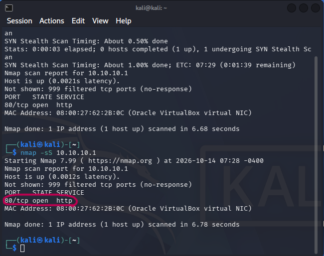
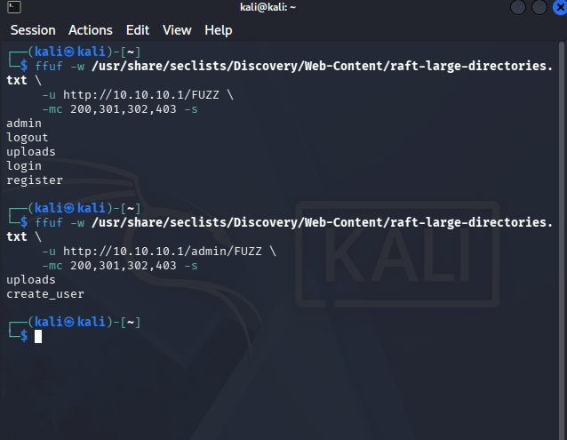
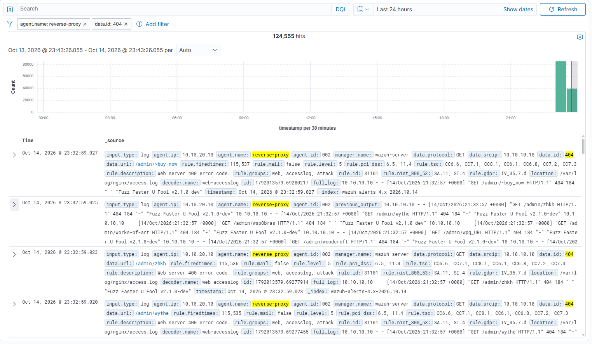

# 01 — Reconnaissance

## Objective

Identify the exposed services and discover the application's public and administrative routes from the attacker network.

## Commands

Run these commands from the Kali attacker machine:

```bash
nmap -sV -p 80 10.10.10.1

ffuf -w /usr/share/seclists/Discovery/Web-Content/raft-large-directories.txt \
     -u http://10.10.10.1/FUZZ \
     -mc 200,301,302,403
```

## Execution and expected result

The scan should reveal the HTTP service exposed through OPNsense. Directory enumeration may reveal routes such as the login page, administrative pages, and upload functionality.





## Wazuh view

```json
{
  "_index": "wazuh-alerts-4.x-2026.10.14",
  "_id": "abAfO6EB4a_eJvAFFXbY",
  "_version": 1,
  "_score": null,
  "_source": {
    "predecoder": {
      "hostname": "OPNsense.internal",
      "program_name": "filterlog",
      "timestamp": "Oct 14 17:54:03"
    },
    "input": {
      "type": "log"
    },
    "agent": {
      "name": "wazuh-server",
      "id": "000"
    },
    "previous_output": "Oct 14 17:54:02 OPNsense.internal filterlog[93022]: 59,,,3d399f8f89b68d684701badb48eab085,em0,match,block,in,4,0x0,,64,41822,0,DF,6,tcp,64,10.10.10.10,10.10.10.1,46574,443,0,A,,4157124088,338,,nop;nop;TS;nop;nop;sack\nOct 14 17:53:59 OPNsense.internal filterlog[93022]: 59,,,3d399f8f89b68d684701badb48eab085,em0,match,block,in,4,0x0,,64,41821,0,DF,6,tcp,115,10.10.10.10,10.10.10.1,46574,443,63,FPA,3380008230:3380008293,4157124088,338,,nop;nop;TS\nOct 14 17:53:58 OPNsense.internal filterlog[93022]: 59,,,3d399f8f89b68d684701badb48eab085,em0,match,block,in,4,0x0,,64,41820,0,DF,6,tcp,52,10.10.10.10,10.10.10.1,46574,443,0,A,,4157124088,338,,nop;nop;TS\nOct 14 17:53:57 OPNsense.internal filterlog[93022]: 59,,,3d399f8f89b68d684701badb48eab085,em0,match,block,in,4,0x0,,64,41819,0,DF,6,tcp,64,10.10.10.10,10.10.10.1,46574,443,0,A,,4157124087,338,,nop;nop;TS;nop;nop;sack\nOct 14 17:53:55 OPNsense.internal filterlog[93022]: 59,,,3d399f8f89b68d684701badb48eab085,em0,match,block,in,4,0x0,,64,41818,0,DF,6,tcp,115,10.10.10.10,10.10.10.1,46574,443,63,FPA,3380008230:3380008293,4157124087,338,,nop;nop;TS\nOct 14 17:53:55 OPNsense.internal filterlog[93022]: 59,,,3d399f8f89b68d684701badb48eab085,em0,match,block,in,4,0x0,,64,41817,0,DF,6,tcp,64,10.10.10.10,10.10.10.1,46574,443,0,A,,4157124087,338,,nop;nop;TS;nop;nop;sack\nOct 14 17:53:54 OPNsense.internal filterlog[93022]: 59,,,3d399f8f89b68d684701badb48eab085,em0,match,block,in,4,0x0,,64,41816,0,DF,6,tcp,64,10.10.10.10,10.10.10.1,46574,443,0,A,,4157124087,338,,nop;nop;TS;nop;nop;sack\nOct 14 17:53:54 OPNsense.internal filterlog[93022]: 59,,,3d399f8f89b68d684701badb48eab085,em0,match,block,in,4,0x0,,64,41815,0,DF,6,tcp,115,10.10.10.10,10.10.10.1,46574,443,63,FPA,3380008230:3380008293,4157124087,338,,nop;nop;TS\nOct 14 17:53:53 OPNsense.internal filterlog[93022]: 59,,,3d399f8f89b68d684701badb48eab085,em0,match,block,in,4,0x0,,64,41813,0,DF,6,tcp,115,10.10.10.10,10.10.10.1,46574,443,63,FPA,3380008230:3380008293,4157124087,338,,nop;nop;TS\nOct 14 17:53:53 OPNsense.internal filterlog[93022]: 59,,,3d399f8f89b68d684701badb48eab085,em0,match,block,in,4,0x0,,64,41812,0,DF,6,tcp,64,10.10.10.10,10.10.10.1,46574,443,0,A,,4157124087,338,,nop;nop;TS;nop;nop;sack\nOct 14 17:53:53 OPNsense.internal filterlog[93022]: 59,,,3d399f8f89b68d684701badb48eab085,em0,match,block,in,4,0x0,,64,41814,0,DF,6,tcp,64,10.10.10.10,10.10.10.1,46574,443,0,A,,4157124087,338,,nop;nop;TS;nop;nop;sack",
    "data": {
      "protocol": "udp",
      "srcip": "10.10.10.10",
      "dstport": "53",
      "length": "41",
      "action": "block",
      "srcport": "56075",
      "dstip": "1.1.1.1",
      "id": "3d399f8f89b68d684701badb48eab085"
    },
    "manager": {
      "name": "wazuh-server"
    },
    "rule": {
      "mail": false,
      "level": 10,
      "pci_dss": [
        "1.4",
        "10.6.1"
      ],
      "hipaa": [
        "164.312.a.1",
        "164.312.b"
      ],
      "tsc": [
        "CC6.7",
        "CC6.8",
        "CC7.2",
        "CC7.3"
      ],
      "description": "Multiple pfSense firewall blocks events from same source.",
      "groups": [
        "pfsense",
        "multiple_blocks"
      ],
      "nist_800_53": [
        "SC.7",
        "AU.6"
      ],
      "frequency": 18,
      "firedtimes": 1,
      "mitre": {
        "technique": [
          "Brute Force"
        ],
        "id": [
          "T1110"
        ],
        "tactic": [
          "Credential Access"
        ]
      },
      "id": "87702",
      "gpg13": [
        "4.12"
      ]
    },
    "location": "192.168.1.1",
    "decoder": {
      "name": "pf"
    },
    "id": "1791993245.51388",
    "full_log": "Oct 14 17:54:03 OPNsense.internal filterlog[93022]: 59,,,3d399f8f89b68d684701badb48eab085,em0,match,block,in,4,0x0,,64,8642,0,DF,17,udp,61,10.10.10.10,1.1.1.1,56075,53,41",
    "timestamp": "2026-10-14T15:54:05.253+0000"
  },
  "fields": {
    "timestamp": [
      "2026-10-14T15:54:05.253Z"
    ]
  },
  "highlight": {
    "location": [
      "@opensearch-dashboards-highlighted-field@192.168.1.1@/opensearch-dashboards-highlighted-field@"
    ]
  },
  "sort": [
    1791993245253
  ]
}
```


As we can see, there are 124.555 `GET` requests with 404 response code from the reverse proxy.
## Mitigation

- Expose only the required ports through OPNsense.
- Rate-limit requests at Nginx.
- Monitor bursts of `404` responses and repeated path discovery.
- Avoid exposing administrative routes publicly; require an additional access control layer where possible.